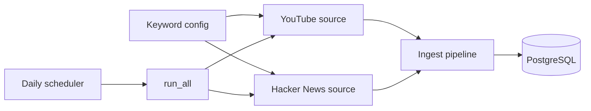

# Social Feedback Insight Engine

Collects public discussion about AI coding assistants (Claude Code, Cursor,
GitHub Copilot) from YouTube and Hacker News, stores it in PostgreSQL, and
(in upcoming sprints) turns it into sentiment, themes, and trend alerts.

## Architecture



## Features (Sprint 1)
- Keyword-driven video discovery (recent videos with 25K+ views and comments enabled)
- Pluggable source interface: a new platform is one new file
- Idempotent inserts: re-running never creates duplicates
- Run log table recording status and counts for every ingestion
- Daily scheduled job in Docker; CI runs tests on every push

## Quick start
```bash
cp .env.example .env        # set your own password and YOUTUBE_API_KEY
docker compose up -d --build
```
The scheduler runs daily at 02:00 UTC (change with `RUN_HOUR_UTC` / `RUN_MINUTE_UTC`).
Run once manually:
```bash
pip install -r requirements.txt
python -m backend.ingestion.run_all
```

## Design decisions
- **Reddit:** Reddit now requires approval for API access and my request was
  not approved, so the source interface made swapping in Hacker News trivial.
- **Idempotency:** `UNIQUE (source_id, external_id)` + `ON CONFLICT DO NOTHING`.
- **Fault isolation:** one failing source never stops the others.
- **Config:** all settings come from environment variables (12-factor).
- **Quota-aware:** discovery uses few expensive search calls, then cheap batch lookups.

## Current data
  platform  | sources | posts 
------------+---------+-------
 hackernews |       3 |  1160
 youtube    |     118 | 15657

## Roadmap
- Sprint 2: sentiment (Hugging Face), embeddings, BERTopic clustering, Celery + Redis
- Sprint 3: FastAPI + React dashboard, LLM cluster summaries
- Sprint 4: anomaly alerts, tests, deployment, metrics